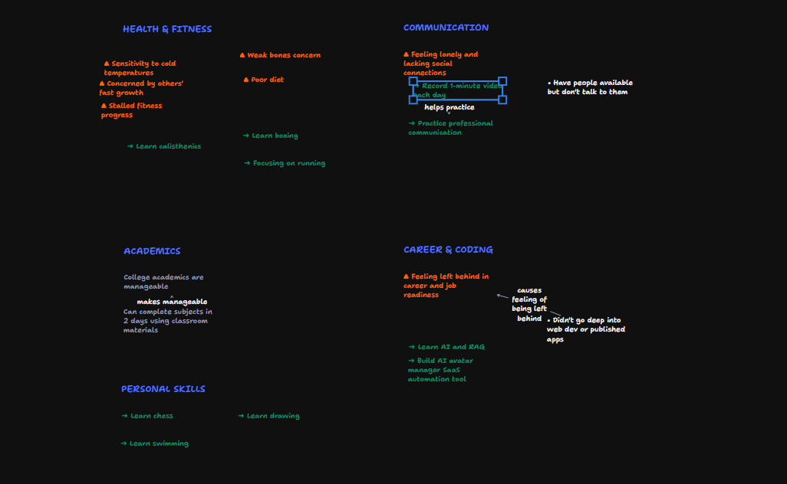

# ThoughtCanvas — Freeform AI Brain-Dump Whiteboard

A freeform digital whiteboard for brain dumping, with AI helping organize and classify thoughts into loose whiteboard clusters.

```text
User types or speaks brain dump
              ↓
Text appears in input (editable)
              ↓
       Organize Thoughts
              ↓
FastAPI → Gemini → Semantic Items JSON
              ↓
tldraw infinite canvas (freeform layout)
```

## Project layout

```text
backend/     FastAPI + Gemini SDK (Python)
frontend/    React + Vite + tldraw (JavaScript)
```

## 1. Backend setup

Requires Python 3.10+ and a [Gemini API key](https://aistudio.google.com/apikey).

```powershell
cd backend
python -m venv .venv
.\.venv\Scripts\Activate.ps1
pip install -r requirements.txt
copy .env.example .env
```

On macOS/Linux:

```bash
cd backend
python -m venv .venv
source .venv/bin/activate
pip install -r requirements.txt
cp .env.example .env
```

Edit `backend/.env`:

```env
GEMINI_API_KEY=your_api_key_here
GEMINI_MODEL=gemini-2.5-flash
```

Start the API:

```powershell
uvicorn main:app --reload --port 8000
```

Health check: `GET http://127.0.0.1:8000/api/health` → `{"status":"ok"}`

## 2. Frontend setup

In a second terminal:

```powershell
cd frontend
npm install
npm run dev
```

Open `http://localhost:5173`

The Vite dev server proxies `/api` to the FastAPI backend on port 8000.

## How to use

1. **Freeform Whiteboard**: Draw, write text, add shapes, arrows, notes anywhere on the infinite canvas at any time.
2. **AI Brain Dump**:
   - Type messy thoughts into the bottom input box, or click the microphone 🎤 to speak.
   - Click **Organize Thoughts** (or press Ctrl+Enter / Cmd+Enter).
   - Gemini extracts semantic thoughts into structured items classified by type (`area`, `concern`, `problem`, `plan`, `opinion`, `observation`, `question`, `note`).
   - Items are placed onto the canvas in a loose, whiteboard arrangement grouped by area (not a rigid graph).
3. **Continue Arranging**: Drag, group, draw arrows, circle items, or add new shapes freely.
4. **Theme**: Switch between Light and Dark mode using the ☀ / ☾ button in the header.

## API

`POST /api/organize`

Request:

```json
{
  "text": "My body is getting worse. I get sick whenever the temperature changes, my joints feel weak, gym progress is slow. I want to learn Python."
}
```

Response:

```json
{
  "items": [
    {
      "id": "item_1",
      "text": "Health & Fitness",
      "kind": "area",
      "areas": ["Health & Fitness"]
    },
    {
      "id": "item_2",
      "text": "Getting sick when temperature changes",
      "kind": "concern",
      "areas": ["Health & Fitness"]
    },
    {
      "id": "item_3",
      "text": "Weak joints",
      "kind": "concern",
      "areas": ["Health & Fitness"]
    },
    {
      "id": "item_4",
      "text": "Gym progress is slow",
      "kind": "problem",
      "areas": ["Health & Fitness"]
    },
    {
      "id": "item_5",
      "text": "Learn Python",
      "kind": "plan",
      "areas": ["Skills"]
    }
  ]
}
```

## Semantic Kinds

- `area`: Broad life domain (e.g. Health & Fitness, Career, Skills)
- `concern`: Worries, uncertainties, vulnerabilities
- `problem`: Explicitly stated obstacles, difficulties, issues
- `plan`: Intentions or actions to take
- `opinion`: Beliefs, interpretations, comparisons
- `observation`: Neutral facts or experiences noted
- `question`: Inquiries or uncertainties to explore
- `note`: General fallback information

## Voice input

Uses the browser Web Speech Recognition API directly on the client. Audio is not transmitted to any backend.
